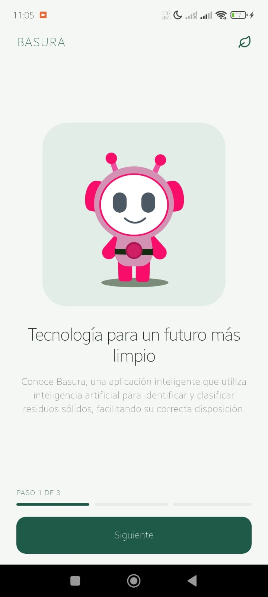
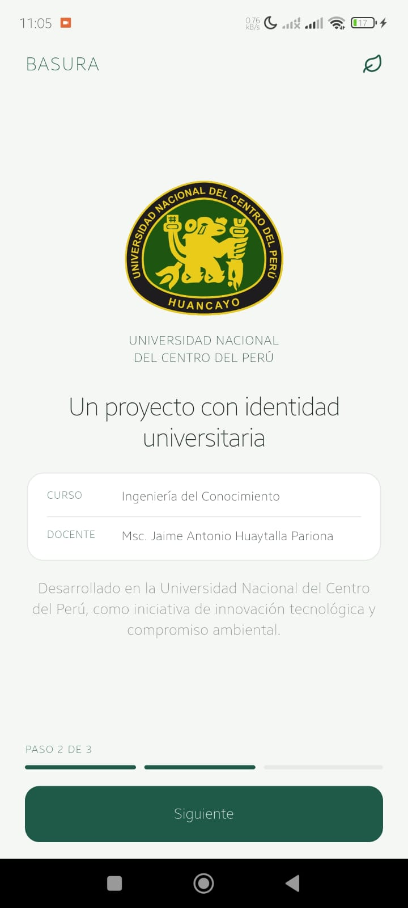

# ♻️ Clasificación de residuos sólidos con CNN

Este proyecto reúne el entrenamiento y evaluación de un clasificador de residuos y una aplicación móvil para probar la clasificación. El notebook desarrolla el modelo en Google Colab; la app **Basura** está implementada por separado con Flutter y ejecuta el modelo TensorFlow Lite en el dispositivo.

## Recursos del proyecto

- [Notebook de Google Colab](https://colab.research.google.com/drive/14_Ifi5ywh3JHFZfpcVhawzfFSUlePuQn?usp=sharing#scrollTo=b2c5e9b4) — código, análisis, entrenamiento y exportación del modelo.
- [Código fuente de la app Basura](https://github.com/DavisAndriyTomasRivera/basura) — proyecto móvil Flutter.
- [Notebook incluido en este repositorio](./Proyecto_CNN_Residuos_Solidos.ipynb).

## ¿Qué hace el notebook?

El notebook documenta el flujo de aprendizaje automático de principio a fin:

1. **Define el problema:** predecir la categoría de un residuo a partir de una imagen y sugerir el contenedor correspondiente.
2. **Integra datos:** combina Garbage-Classification v6 y Waste-Classification v3 de Roboflow, RealWaste (UCI) y recortes de objetos de TACO. Normaliza las etiquetas en siete categorías y separa los conjuntos de entrenamiento, validación y prueba.
3. **Preprocesa las imágenes:** las ajusta a 224 × 224 píxeles, aplica aumento de datos y usa pesos de clase para atender el desbalance.
4. **Entrena y compara tres modelos:**
   - Una CNN propia con bloques residuales.
   - MobileNetV2 con el extractor de características congelado (*Feature Extraction*).
   - MobileNetV2 con ajuste fino parcial de sus capas (*Fine-Tuning*).
5. **Evalúa los resultados:** calcula métricas por clase y por fuente de datos, matrices de confusión y errores sobre el conjunto de prueba.
6. **Exporta el modelo:** selecciona MobileNetV2 Fine-Tuning y lo convierte a TensorFlow Lite, incluyendo una variante FP16, junto con metadatos de clases, preprocesamiento y resultados.

El notebook está pensado para ejecutarse en Google Colab con GPU. La descarga de datasets puede requerir configurar acceso o credenciales para las fuentes correspondientes.

### Categorías

| Clase predicha | Contenedor sugerido |
|---|---|
| `plastico` | Tacho blanco |
| `papel_carton` | Tacho azul |
| `vidrio` | Tacho verde |
| `metal` | Tacho amarillo |
| `organico` | Tacho marrón |
| `peligroso` | Tacho rojo |
| `otros` | Tacho negro |

### Resultados registrados

El resumen del notebook reporta los siguientes resultados en el conjunto de prueba:

| Modelo | Accuracy | F1 macro |
|---|---:|---:|
| CNN propia | 0.771 | 0.720 |
| MobileNetV2 Feature Extraction | 0.888 | 0.860 |
| **MobileNetV2 Fine-Tuning** | **0.893** | **0.870** |

El mejor resultado global es el de Fine-Tuning. Sin embargo, la precisión disminuye en imágenes más complejas: el resumen del notebook reporta alrededor de 0.59 de accuracy en TACO. Por eso, la métrica global no garantiza el mismo desempeño con cualquier cámara, iluminación o tipo de residuo.

> **Nota sobre métricas:** el `metadata.json` de la carpeta `modelos/` registra 0.8964 de accuracy y 0.8704 de F1 macro para Fine-Tuning, mientras que el resumen del notebook redondea a 0.893 y 0.870. Los valores corresponden a los artefactos disponibles y pueden reflejar una diferencia entre ejecuciones.

## Aplicación móvil y despliegue

**Basura** es una aplicación móvil desarrollada con Flutter. Integra un modelo TensorFlow Lite para clasificar imágenes localmente, permite seleccionar una imagen, conserva un historial local y contiene secciones de educación ambiental y ajustes. Al ejecutar la inferencia en el dispositivo, no necesita enviar cada imagen a un servicio remoto.

El enlace proporcionado corresponde al **código fuente** de la aplicación; no es un enlace a una versión publicada en una tienda o a una demo web. Para probarla desde el código:

1. Instala Flutter y configura un emulador Android o conecta un dispositivo. Verifica el entorno con `flutter doctor`.
2. Clona el repositorio y ejecuta la app:

   ```bash
   git clone https://github.com/DavisAndriyTomasRivera/basura.git
   cd basura
   flutter pub get
   flutter run
   ```

3. Para generar un APK de lanzamiento:

   ```bash
   flutter build apk --release
   ```

La app registra los modelos y demás recursos desde `assets/`. Si se reemplaza el modelo, hay que comprobar que su ruta, dimensiones de entrada, salida y orden de etiquetas coincidan con lo que espera el clasificador de la app. El notebook especifica una entrada de 224 × 224 píxeles y el orden de clases indicado arriba.

En este directorio también se guardan los artefactos del modelo y sus metadatos:

- `modelos/model_v1.tflite`
- `modelos/model_v1_fp16.tflite`
- `modelos/metadata.json`

La app independiente documenta sus propios recursos en su directorio `assets/`; tener estos archivos aquí no los instala automáticamente en la aplicación.

## Capturas

Las imágenes de `capturas/` muestran pantallas iniciales de la aplicación:

| Bienvenida | Información del proyecto |
|---|---|
|  |  |

## Contexto académico

Proyecto del curso **IS056B — Ingeniería del Conocimiento**, Universidad Nacional del Centro del Perú (UNCP), 2026-II.

**Integrantes:** Echegoyen Rojas Anahi, Espinoza Inga Deysi, Paucar Ramirez Carolina y Tomas Rivera Andriy.
